---
format:
  docx:
    number-sections: false
    reference-doc: assets/report_style.docx
---

by Fuad Babaiev, Katie Bowles, Jonathan Chen

MET AD688: Big Data and Cloud Analytics for Business

Professor Nakul Padalkar

October 12, 2026

# Executive Summary

The purpose of this project was to explore the current job market for the NAICS code 523 and provide recommendations for job applicants or those seeking a career change based on analytics of real time job posting data.. Within this report the focus is on business intelligence and analyst careers.

The data consists of 7,000 job postings after cleaning of the dataset. On this dataset basic market baselines were established and various analyses were performed. The result of this was a series of recommendations that are summarized as follows:

1.  **Learn a new skill focusing on machine learning and related skills such as Python and SQL.**

2.  **Be specific in job application materials.**

3.  **The median experience is three years. Plan an entry route early.**

4.  **Search by specific skills and employers rather than titles.**

5.  **The top companies to explore are Amazon, Citi, U.S. Bank, JPMorgan Chase, PNC and State Street.**

6.  **Location adds little value, search instead by work arrangement.**

Applicants should take these recommendations into consideration when moving forward with their search or career plans. However, use caution when applying them as the job market is ever changing and no change is guaranteed to have an impact. The recommendations found within this report are suggestions intended to augment an individual\'s experience and positively impact their career intentions based on the various analyses and statistics explored within.

**Table of Contents**

[**Executive Summary 1**](#executive-summary)

[**Product Framing 3**](#_heading=)

> [Target Audience 3](#_heading=)
>
> [Career Pathway 3](#_heading=)
>
> [Industry 3](#_heading=)
>
> [The Driving Question 4](#_heading=)

[**Scope and Data 5**](#_heading=)

> [The Data 5](#_heading=)
>
> [Sample Construction 5](#_heading=)
>
> [Repairing the Data 6](#_heading=)
>
> [Coverage of the Final Panel 7](#_heading=)

[**Market Baseline 7**](#_heading=)

> [The Results 8](#the-results)

[**Skill-Gap Analysis 9**](#_heading=)

[**Final Analytics 10**](#_heading=)

> [What Was Modeled 10](#_heading=)
>
> [Why It Matters 10](#_heading=)
>
> [Variables and Evaluation 10](#_heading=)
>
> [Impact in Practical Career Terms 12](#_heading=)

[**Recommendations 13**](#_heading=)

[**Limitations 14**](#_heading=)

[**Team Contributions 15**](#_heading=)

[**Product and Repository 15**](#_heading=)

# 

#  

# Product Framing

## Target Audience

This project is geared towards supporting students finishing an analytics program, or individuals pivoting into analytics from an adjacent role, who have to decide **where to apply, what to learn next, and how to present themselves**. This product is intended to support and guide those decisions, not as a general labor-market report. Every analysis in it was included because it has potential impacts on those choices.

## Career Pathway

Business Intelligence and Data Analyst roles were the career focus of this project. The pathway covers the reporting, analysis and decision-support roles that sit between raw data engineering and quantitative research.

## Industry

**NAICS 2022 --- 523, Securities, Commodity Contracts, and Other Financial Investments and Related Activities.** Includes investment banks, brokerages, asset managers and related firms.

The project originally anchored to NAICS 5221, Depository Credit Intermediation. That code returned 59 postings in total, 13 of them with salary information --- too thin to support any significant compensation or skill-gap analysis. After measuring the neighboring codes, the project was re-anchored to NAICS 523, to keep the project inside Finance and Insurance areas and accounts for roughly two-thirds of all analytics postings in that sector.

There were three main reasons behind that decision:

- Finance runs on data, so analytics roles sit close to the core of the organization rather than in a support function,

- Requirements differ measurably from the general analytics market: a regulated environment, market and client data, compliance-aware reporting,

## 

## The Driving Question

To give the project direction, a question needed to be identified. The final goal was to answer **"What does this market actually reward, and what should a job seeker do about it?"** This question is geared towards supplying the intended audience with a product that provides actionable recommendations and suggested paths towards improving the job application search and process.

# Scope and Data

## The Data

The project analysis is built from the **WRDS jobs_2026 dataset** supplied by Professor Nakul Padalkar: 504,208 postings across 134 columns, distributed as twenty-one Parquet parts with a manifest, coverage report, and checksums.

The initial portions of the project relied on a MET Employability Career Match API to acquire the data. Later, the analysis was moved to the dataset provided by Professor Padalkar only after measuring both sources on the exact scope. The switch was not an improvement on every axis- occupational coding became sparser while geography, skills and education all improved, and education and experience stopped being estimates and became the provider's.

## Sample Construction

  ---------------------------------------------------------------------------
  **Stage**                                    **Postings**
  -------------------------------------------- ------------------------------
  Source dataset                               504,208

  In NAICS 523                                 24,914

  Matched the role definition                  8,747

  Removed: information-security roles          −76

  Removed: no publication date                 −1,405

  Removed: published before 1 September 2025   −192

  **Analytical panel**                         **7,074 rows × 57 columns**
  ---------------------------------------------------------------------------

A posting was kept when **either** its SOC occupation matched one of nine analytics occupations, **or** its title contained any of: analyst, analytics, data, business intelligence, BI, reporting, SQL, data science, or machine learning. A combination was used rather than any alone because occupation codes are present on only a third of postings, so an occupation-only filter would discard two postings in three.

The date window- postings were filtered to those published on or after 1 September 2025- keeps the analysis current. The source reaches back to 2014, and requirements from a decade ago describe a market the target user is not applying into. The window costs only 192 in-scope postings.

## Repairing the Data

Integration testing exposed five defects that coverage statistics alone did not reveal. Each repair is written to a new column so the provider's original value stays auditable; no rows were dropped.

1.  **Job titles overwritten.** On 2,165 postings, the title field holds the occupation name rather than the advertised title, so a vacancy posted as "Sr Financial Analyst, AWS GTM Finance" reads as "Management Analysts". Titles were rebuilt from the raw text, raising distinct titles from 2,396 to 4,000.

2.  **Occupational coding incorrect where present.** Postings titled "Senior Financial Analyst" are coded as "Models, Demonstrators, and Product Promoters". The field is kept and the defect reported, as it is the direct justification for filtering roles by title as well as by code.

3.  **The state field mixes types.** Full names, two-letter codes, the country "United States" (1,202 postings), and the non-place "Remote" (178). Real state coverage is **73%**, not the apparent 92.

4.  **Missing values encoded as a value.** Work arrangement carries a literal "Unknown" on 1,442 postings alongside true nulls, and spells the office category two ways. Experience reports zero years on 2,288 postings, but on 2,143 of those the stated maximum is exactly one- a provider default attached to senior postings, which had forced the median requirement to zero. Removing it leaves 1,702 postings with a real requirement and a median of three years.

5.  **Employer names unusable as given.** On 397 postings the field holds an applicant-tracking hostname; on 229 it names a staffing agency or aggregator rather than the hiring firm; and JPMorgan Chase appeared under three spellings. The provider's own staffing flag cannot find these- it is set on 93 of 7,074 rows and marks TD as staffing while giving JPMorgan Chase both values.

Salary required its own treatment. The provider's SALARY column is a free-text summary that is an empty placeholder on most rows. The usable numbers are the structured range, quoted in different periods --- 1,751 annual, 315 hourly, 18 monthly. Each was validated against bounds appropriate to its own period rather than a single annual rule, which had been silently deleting hourly rates as implausible. **Hourly and monthly rates were kept in their own columns and were not converted to annual figures**, because the conversion needs an assumption about hours worked that the postings do not supply.

## Coverage of the Final Panel

  ----------------------------------------------------------------------
  **Field**                                  **Populated**   **Share**
  ------------------------------------------ --------------- -----------
  Skills                                     7,074           100%

  US state, after normalisation              5,135           73%

  Minimum education level                    4,913           69%

  Work arrangement, after normalisation      3,126           44%

  Occupation code (SOC 2021)                 2,357           33%

  Annual salary usable                       1,741           25%

  Years of experience, after normalisation   1,702           24%
  ----------------------------------------------------------------------

# Market Baseline

To further the project and find the basis, a market baseline needed to be established. To that end, basic statistics were investigated on the data. The team determined that narrowing the scope to what could be considered the most relevant aspects would make the project more digestible. Six main areas were identified: role naming, salary, location, work arrangement (remote, hybrid, in-office, etc.), required experience, and the employers.

## The Results

The main results are as follows:

**1. Demand and how roles are named.** 4,000 distinct titles occurred across the 7,074 postings. The most common, "senior financial analyst", appears 122 times- 1.7% of the panel. The practical consequence is that title-based job alerts miss most of the market.

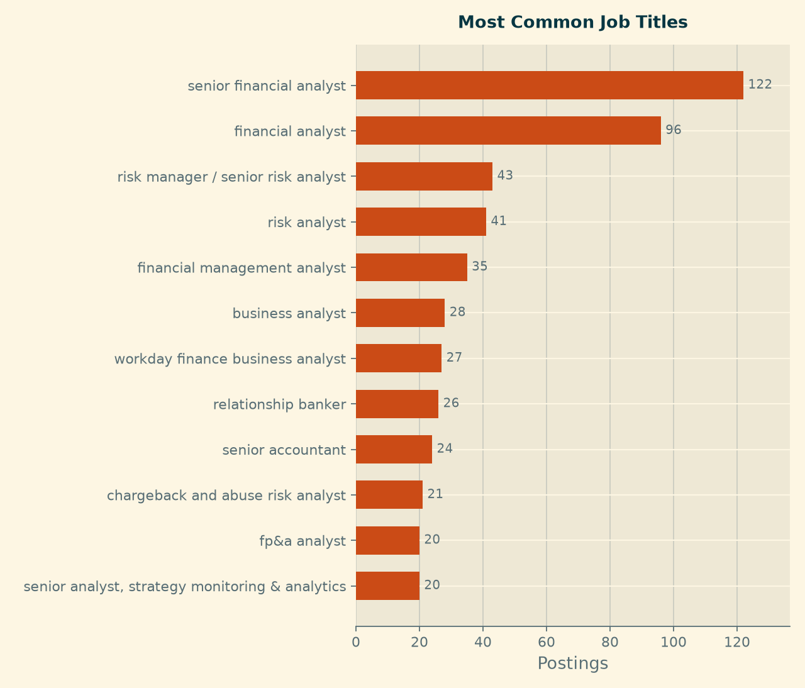{width=6in}{width="4.765625546806649in" height="4.04042104111986in"}

**2. Salary.** Of the total postings, only 1,741 postings (25 %) disclose pay; median annual midpoint \$112,500, middle half \$87,500 to \$141,500.

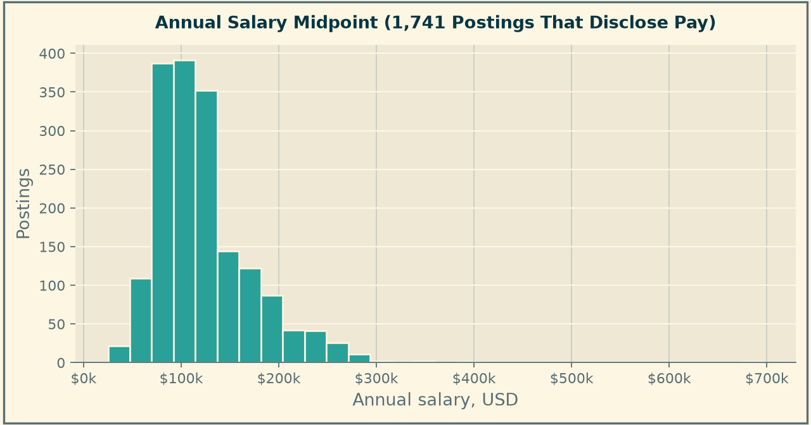{width=6in}{width="5.104166666666667in" height="2.6808803587051617in"}

**3. Location.** A usable state existed on 5,135 postings (73%). The top states were found to be New York with 726 postings, California with 606, Texas with 437, Florida with 286, Illinois with 260. At a city level, New York holds the highest count at 783, *more than the next four cities combined.*

*States with the most postings, among the 5,135 postings carrying a usable state.*

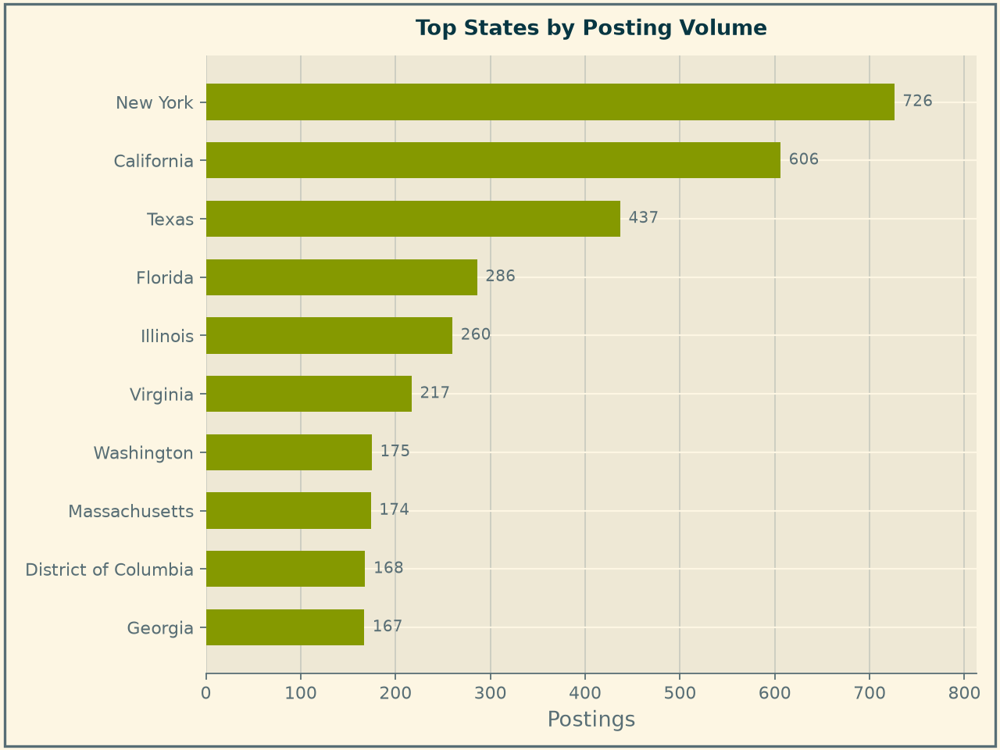{width=6in}{width="4.801311242344707in" height="3.5901695100612425in"}

*Cities with the most postings. New York holds more than the next four combined.*

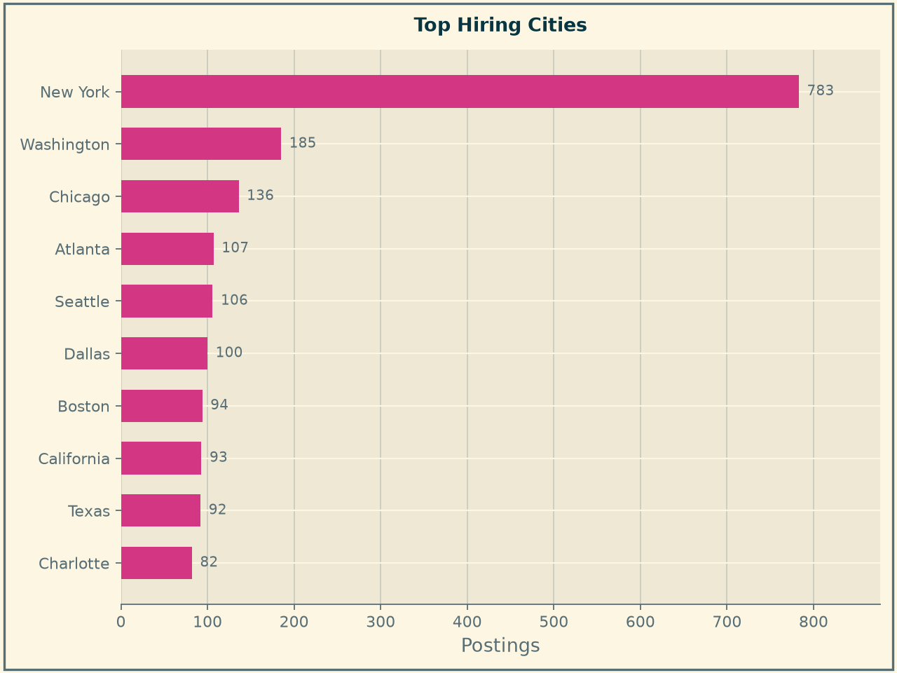{width=6in}{width="4.720866141732284in" height="3.5406496062992128in"}

**4. Work arrangement.** This is recorded on 3,126 postings (44%): hybrid made up 48%, fully remote 32%, and onsite 20%. It is worth noting that this contradicted the prediction set out in the Introduction; for transparency the contradiction is reported rather than making a retroactive adjustment to the hypothesis.

*Work arrangement. Unlabelled postings are shown separately and are never counted as onsite.*

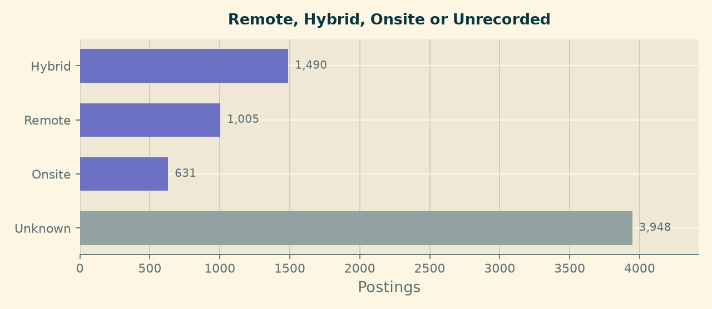{width=6in}{width="6.078665791776028in" height="2.648477690288714in"}

**5. Experience.** A stated requirement on 1,702 of the postings (24%), the experience category had a median of three years with only 49 postings asking for less than a year.

*Minimum years of experience requested, on the 1,702 postings that state a requirement*

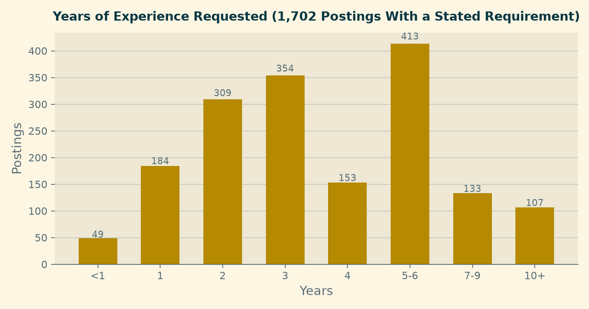{width=6in}{width="7.043169291338582in" height="3.7021784776902886in"}

**6. Employers.** Identifiable on 6,448 postings (91% of the panel) were a total of 2,348 distinct employers. Amazon is the largest at 4.6%, then Citi at 2.2%, U.S. Bank and JPMorgan Chase both at 1.3%.

*Employers with the most postings, after staffing agencies records were set aside.*

# 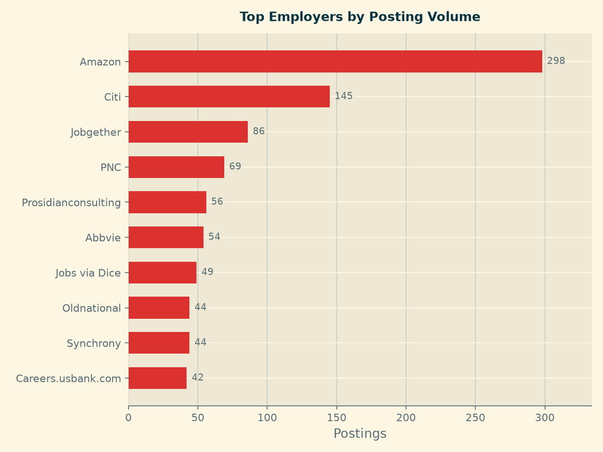{width=6in}{width="6.317708880139983in" height="4.7318864829396325in"}

# Skill-Gap Analysis

In this analysis, the market expectations of in-demand skills are explored. These help create a performance comparison of what employers in the NACIS 523 are potentially searching for in job applicants in this field.

**1. Method.** Three current members of the job force were compared based on nine skill areas relevant to their respective chosen career paths.

The skills:

- **Financial Domain Knowledge**

- **Communication**

- **Dashboard/Reporting**

- **SQL**

- **Python**

- **Cloud Computing**

- **Machine Learning**

- **Git**

- **AWS**

The demand is identified from the 7,074 postings listing any skill in the above. Each individual to the best of their ability scaled themselves on a scale of 1-5, 1 being a beginner level, and 5 being expert level. After the self assessment was completed, python scripts were made to create a skill matrix and to find the market demand for each of the listed skill areas. After this, another script was made to compare the standings of each to the market expectations and see which gaps need to be more addressed than others.

**2. Market demand analysis.** Of the nine skill areas Financial Domain Knowledge is the most in demand at 66.7%. Communication is the second most demanded at 23.5% and third is Dashboard/Reporting at 22.3%. SQL was at 18.4%, Python 12.2%, Cloud Computing 3.6%, Machine Learning 2.8%, Git 0.9%, and AWS 0.5%.

*Share of the 7,074 postings requiring each of the nine skill areas.*

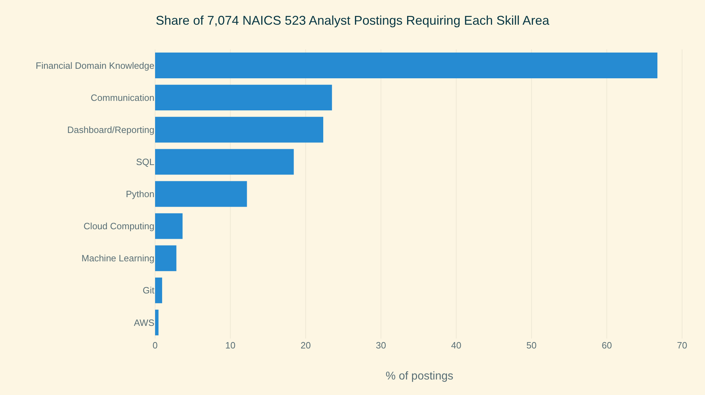{width=6in}{width="5.692708880139983in" height="3.1737128171478566in"}

**3. Gap analysis.** The market share is converted into a target profeciancy due to broad areas would score higher than narrow ones. The cut-offs are based on assumptions. In the comparison between the self-ratings and the market expectations the group reached those expectations in 7 of the 9 skill areas listed.

*Self-assessed team proficiency by skill area, ordered from most to least in demand*

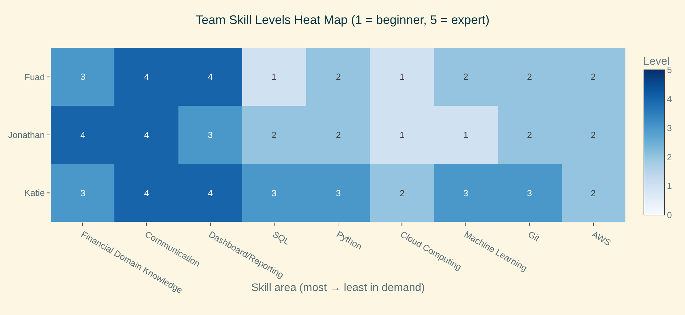{width=6in}{width="7.068678915135608in" height="3.251139545056868in"}

*Levels below the market target, by member and skill area.*

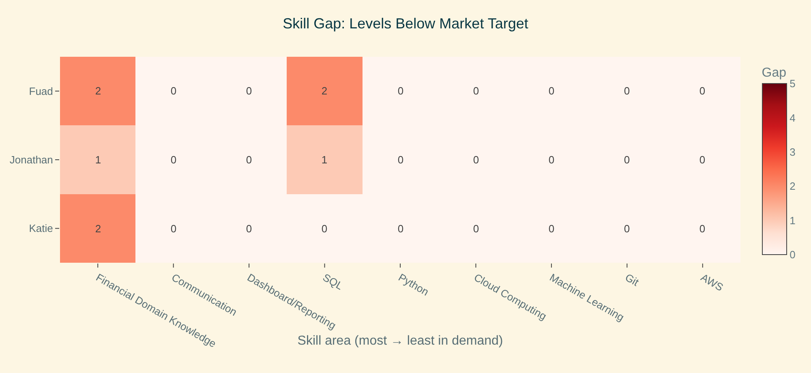{width=6in}{width="7.105040463692038in" height="3.267863079615048in"}

*Team proficiency against the market target for each skill area.*

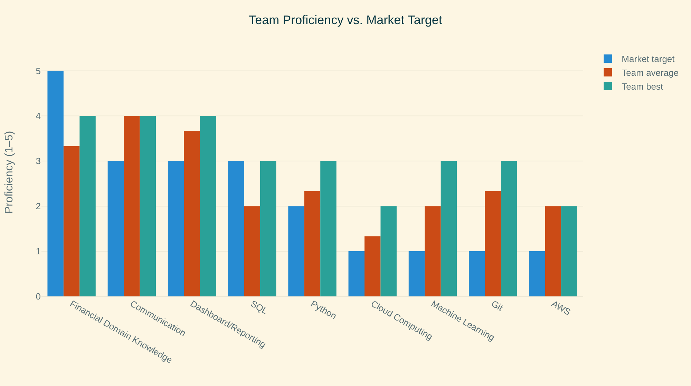{width=6in}{width="6.5in" height="3.638888888888889in"}

**4. Result.** This test group of three overall did not reach the market expectation for Financial Domain. The group is 1 or 2 levels below in the skill department. SQL is another major skill requiring attention. One thing to mention is that financial domain is a very broad skill area because it covers topics like accounting, financial analysis, and services. A way for the group to help close those skill gaps is to do online courses using platforms such as Coursera or Udemy. Youtube or online projects related to these topics will aid in closing these gaps. Another way is to have a member in the group who is strong in this specific skill aid or teach us. For example, someone who is proficient in SQL can guide the others through a SQLO exercise.

#  

# Final Analytics

## What Was Modeled

Two models were created using the same input: a binary indicator for each of the **179 skills appearing in at least one percent of the panel**. Postings list a median of ten skills each, drawn from 3,327 distinct names. The skill field is stored as a JSON list and is parsed as one- splitting it on a delimiter collapses an entire posting into a single skill and produces plausible-looking but meaningless counts.

**Track 1, pay.** Ridge regression was conducted on the natural log of the annual salary midpoint. Pay runs from \$25,000 to \$696,000 against a median of \$112,500, so a model on the raw figure would chase a handful of large ranges; logs also make each coefficient readable as an approximate percentage effect.

**Track 2, reachability.** Logistic classification of entry level- a stated requirement of two years or less-was made against advanced. The split is 542 against 1,160, so the model is fitted with balanced class weights.

## Why It Matters

A candidate or job seeker choosing what to learn is making an investment decision, and a candidate or job seeker choosing where to apply is spending limited attention. The first model says which skills sit in better-paid postings; the second says which postings are realistically open to someone without years of experience.

## Variables and Evaluation

Both models were fitted on a 75% sample and judged on a held-out quarter never seen in training, with penalties chosen by cross-validation.

For regression on pay, n = 1,741:

  -----------------------------------------------------------------------------------------------------
  **Model**                              **Held-out R²**   **CV R²**      **RMSE**       **MAE**
  -------------------------------------- ----------------- -------------- -------------- --------------
  Predict the median for everyone        −0.014            ---            \$51,224       \$36,576

  Skills only                            0.366             0.299          \$40,930       \$28,751

  Skills + geography and remote status   **0.373**         **0.319**      **\$40,821**   **\$28,552**
  -----------------------------------------------------------------------------------------------------

For classification of seniority, n = 1,702:

  -------------------------------------------------------------------------------------
  **Metric**                          **Model**                **Majority Baseline**
  ----------------------------------- ------------------------ ------------------------
  Accuracy                            0.678                    **0.681**

  ROC AUC                             **0.741**                0.500

  Entry: precision / recall / F1      0.50 / **0.67** / 0.57   --- / **0.00** / ---

  Advanced: precision / recall / F1   0.81 / 0.68 / 0.74       0.68 / 1.00 / 0.81
  -------------------------------------------------------------------------------------

Two results need stating honestly. The skill mix explains roughly a third of the variation in pay, and **adding geography barely changes it**- 0.366 to 0.373- so in this industry what the job asks for matters more than where it is. In addition, the classifier **does not beat the baseline on accuracy**. It is marginally worse. But the baseline reaches 68% by calling every posting advanced, which identifies zero of the openings a student could apply to, while the model finds 91 of 136. For a product whose job is to say "apply here", that is the entire value, and an AUC of 0.741 confirms the signal is real rather than noise.

Guards were applied before any coefficient was reported: a minimum of 30 supporting postings, completely separated skills flagged as direction-only, and the 21 skills whose conditional estimate and raw share disagreed were held out of the findings rather than mixed in.

*Estimated effect of each skill on annual pay, from the ridge regression.*

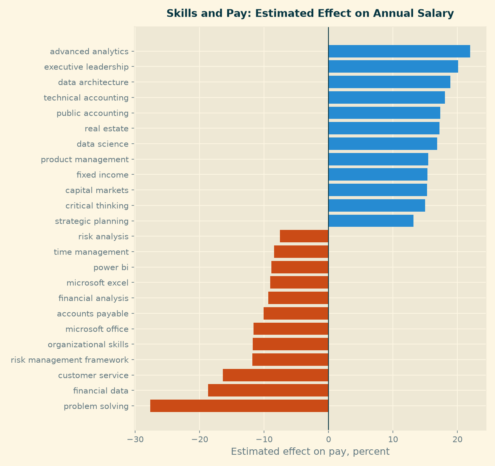{width=6in}{width="6.5in" height="6.125in"}

*Seniority classifier: confusion matrix on the held-out postings.*

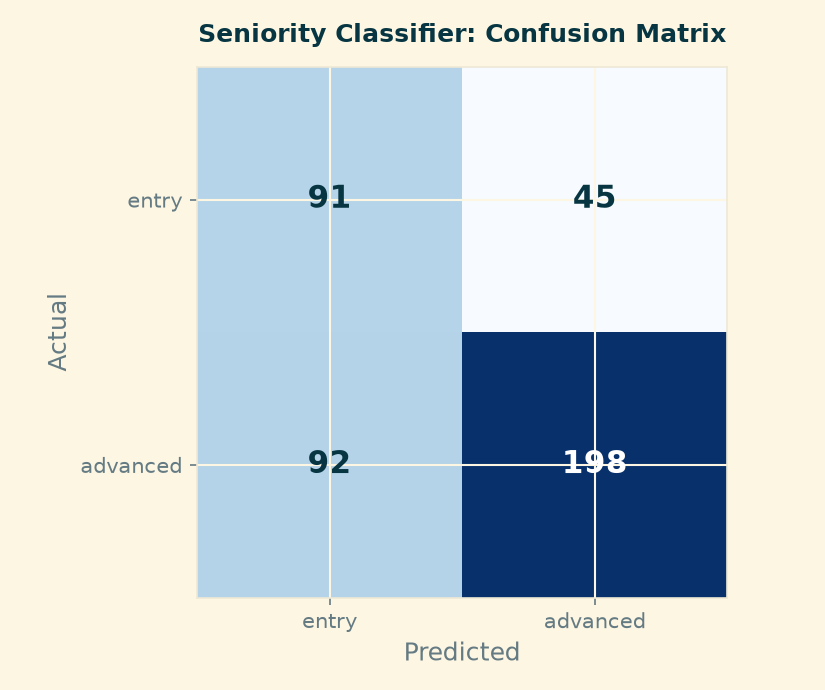{width=6in}{width="6.5in" height="5.444444444444445in"}

## Impact in Practical Career Terms

**Specificity is what the market pays and promotes.** The division is not stemming from technical versus non-technical. Comparing pairs one can see that "financial analysis" is associated with 9% lower pay while "fixed income" and "capital markets" each add 15; "problem solving" costs 28% while "data architecture" adds 19. The classifier agrees- the markers of a senior posting are data governance (97% advanced), bank secrecy act (98%), technical accounting (88%), and general ledger (85%).

**Excel is the floor, not the ladder.** It appears in 779 of the 1,741 salaried postings, more than any other skill, but it is associated with lower pay. Among the top salary quartile, Excel as a skill appears in 25.6% of postings; among the bottom quartile, 51.8%.

**One skill set pays well without demanding years.** Machine learning appears in 7.6% of top-quartile postings and in **none** of the bottom quartile, yet on the seniority split it sits at the base rate- 67% advanced against 68% overall. Data science behaves similarly. For a student leaving a program this is the clearest point of leverage in the data: a capability that raises the pay a posting offers without raising the experience it demands.

**The entry-level signal is weak, and that is itself a finding.** Against a base rate of 68% advanced, only a few skills sit meaningfully below it. Postings announce seniority clearly; they do not announce accessibility.

# Recommendations

From the project analyses run, a few main points stand out. Below, these findings are condensed into simple and concise recommendations for job seekers.

- **What to learn.** The first step for an individual seeking entry into the focused career is to acquire a new skill. Specifically, Python or SQL rather than a common such as Excel- Python appears in 33% of top-quartile postings against 9.8% of bottom-quartile ones. Machine learning is the highest-leverage addition for someone without years of experience.

- **How to write a job application.** Constructing a set of job application materials that is appealing to employers of the analyst category requires specificity in the communication of the applicant's qualifications. The intent should be to name specific capabilities rather than generic ones.

- **What to expect.** Applicants and job seekers should expect a mid-career market: a median of three years of experience where a requirement is stated, with only 49 postings in 1,702 asking for less than a year. They should plan an entry route rather than assuming one exists.

- **How to search.** Findings indicate that applicants and job seekers should search by specific skills and employers and not by title or occupation code. In the data there are 4,000 distinct titles, the most common covering only 1.7%, and occupation codes demonstrably wrong where present.

- **Where to look.** Citi, U.S. Bank, JPMorgan Chase, PNC and State Street create a short list of top companies that when combined with Amazon (the top employer) they hold roughly one posting in ten. The other nine in ten are spread across over 2,000 employers, so breadth still matters.

- **Geography.** Location combined with work arrangement is important to consider. Including hybrid and remote as well as jobs with unknown arrangement listings broadens the search results beyond just a location. Four in five postings that record an arrangement are remote or hybrid, which widens the options well beyond residence location.

# Limitations

However, even with these recommendations there are limitations to highlight that job seekers and applicants should be aware of.

- **Being to specific.** Tailoring a profile to a specific posting may not be able to make it applicable to other postings. Consider that one position requires python but the other needs more emphasis on communication it may make the profile appear weak for the job posting requiring communication as a skill.

- **Correlation not causation.** Matching the skills to the posting does not guarantee a position will be offered.

- **Referrals and networking.** Job posting and interviews are not the only way a position will be filled. Referrals and networking are other ways recruiters look to fill positions.

- **Certification payoff.** Securing a certification to improve standing also may not guarantee the position will be offered. The job market always changes its preferences, and investing time and money is something that must be weighed.

- **Skills are not the only factor.** In securing a job position, not only skills play a factor: education, experience, and job interview performance also help with an applicant\'s standing on the job posting.

- **A changing market.** The job market requirements change very frequently, so what may be required this year may not be required next year. Applicants and job seekers can prepare ahead of time for a desired position, but if the position changes the required or preferred skills, it can cost a lot of time and money that may not pay off.

# Team Contributions

  --------------------------------------------------------------------------------------------------------------------------------------------------------------------------------------------------------------------------------------------
  **Member**                     **Contribution**
  ------------------------------ -------------------------------------------------------------------------------------------------------------------------------------------------------------------------------------------------------------
  Fuad Babaiev                   Site structure and navigation; panel construction and field normalisation; employer cleanup; final analytics (regression and classification); evaluation logic; report assembly and publishing

  Katie Bowles                   Data cleaning; market baseline analysis and figures; shared visual theme; career strategy and recommendations; site requirements check and editing; presentation and report writing, creation, and editing.

  Jonathan Chen                  Skill gap analysis: team skill matrix, market demand measurement, gap heat maps and learning order; limitations
  --------------------------------------------------------------------------------------------------------------------------------------------------------------------------------------------------------------------------------------------

# Product and Repository

Live site: https://fuadbbv.github.io/ad688-career-evaluation-group1/

Repository: https://github.com/fuadbbv/ad688-career-evaluation-group1
